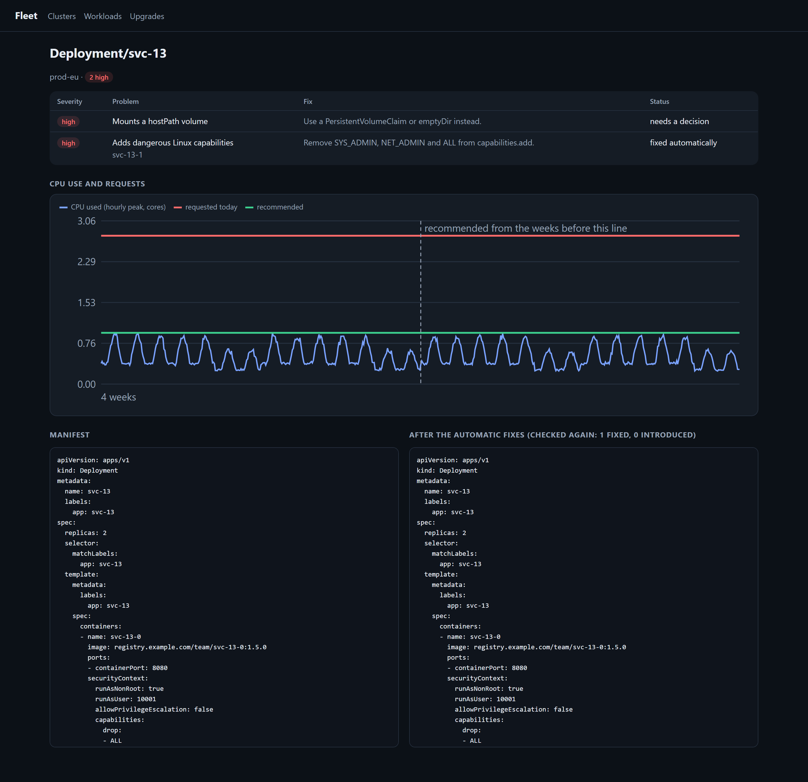
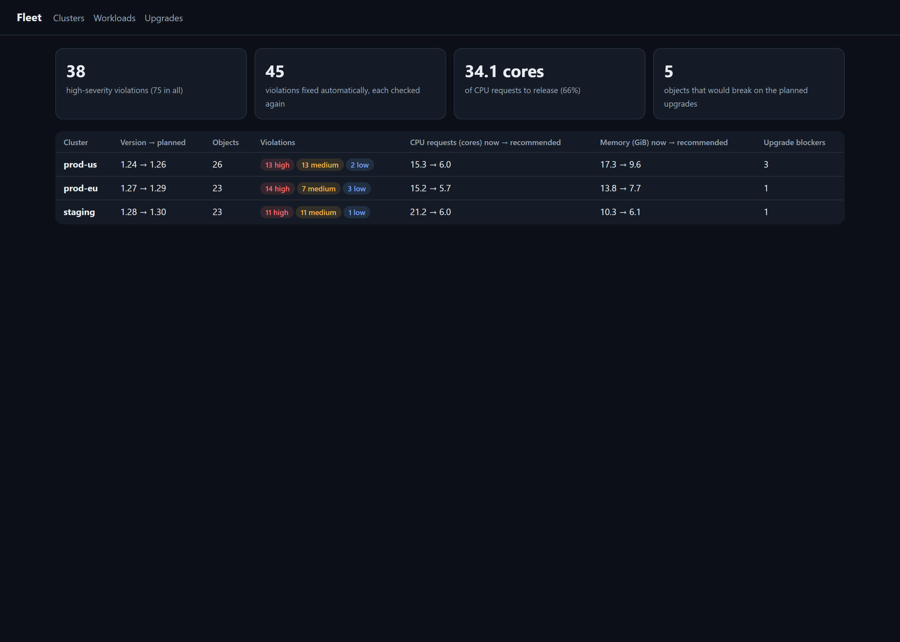
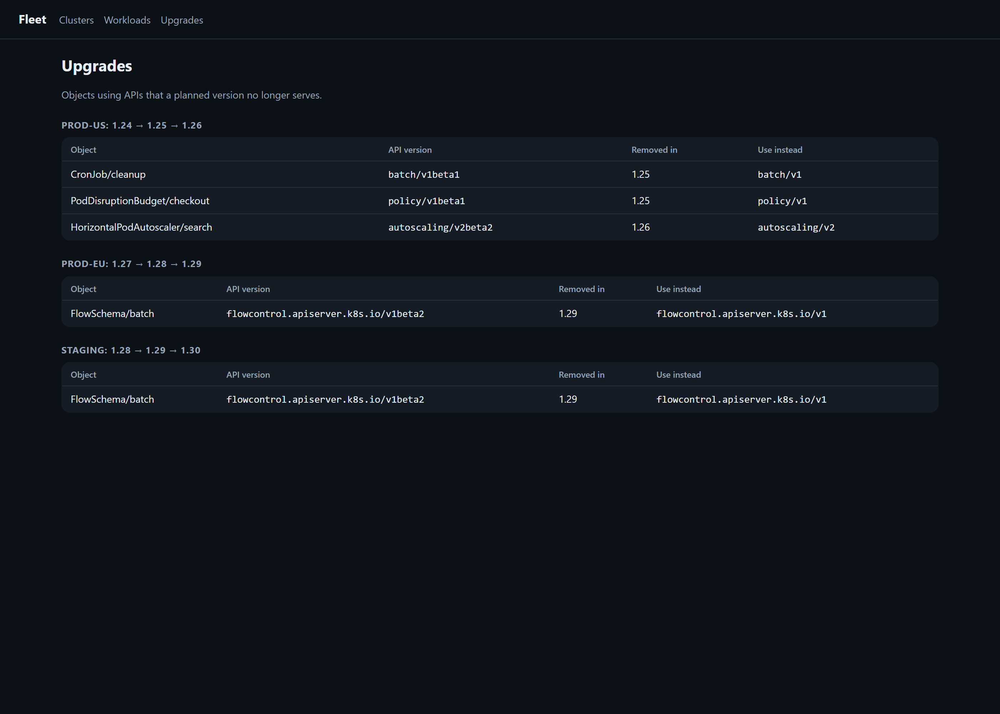

# Enterprise Kubernetes Management Platform

[](https://github.com/codeROCK-IZZY/kubernetes-management-platform/actions/workflows/ci.yml)


Fleet management for teams running several Kubernetes clusters, with four parts:

- **Admission policies.** Eleven security and reliability rules (privileged containers, root users,
  privilege escalation, dangerous capabilities, missing requests and limits, unpinned images, hostPath, host
  namespaces, missing probes, wildcard RBAC), evaluated on the parsed objects the way Kubernetes reads them.
- **Fixes that are proven.** Automatic fixes for the rules with one safe answer, and Claude-proposed patches for the
  rest. Every fix is accepted only after the policy engine checks the result again.
- **Rightsizing.** CPU and memory requests from usage history, judged on the weeks after the recommendation.
- **Upgrade readiness.** Objects using APIs that the planned Kubernetes version no longer serves.



## Results

`kubefleet evaluate --gate` uses generated manifests whose violations are known in advance, 360 per bank. The engine
was written against the first bank. The third bank's forms were written only after the engine was frozen:

- CronJobs and Jobs nested two levels deep;
- violations only in init or ephemeral (debug) containers;
- containers overriding the pod's security settings;
- images pinned by digest, and registry ports that are not tags;
- multi-document files, YAML anchors, JSON manifests, and comments mentioning `privileged: true`.

| Admission policies, F1 | Policy engine | Searching the YAML text |
|---|---:|---:|
| Forms the engine was written against | 1.000 | 0.725 |
| Same forms, new manifests | 1.000 | 0.707 |
| **Forms written after freezing** | **1.000** | **0.335** |

Automatic fixes repaired **829 of 829** auto-fixable violations across the three banks and introduced **0** new ones.

Rightsizing used four weeks of 5-minute usage per workload. Recommendations were made from the first two weeks and
judged on the next two. Settings were chosen on 200 tuning workloads. The results come from 300 held-out workloads
of the same shapes and 200 of shapes held back (nightly batch bursts and a slow leak):

| Rightsizing, judged on the following two weeks | CPU vs today | Memory vs today | Time above the CPU request | OOM-killed |
|---|---:|---:|---:|---:|
| Held-out: average x 1.2 | 26.9% | 49.9% | 21.1% | 0 of 300 |
| **Held-out: recommended (this platform)** | 40.4% | 52.9% | **0.1%** | 0 of 300 |
| Held back: average x 1.2 | 9.4% | 39.3% | 18.2% | **92 of 200** |
| **Held back: recommended** | 19.3% | 54.5% | 1.3% | **0 of 200** |

What the numbers show:

- **Text search can't read Kubernetes.** It flags "ALL" in `capabilities.drop` as a dangerous capability, misses a
  violation that sits in one of two containers, asks a CronJob for probes, and treats a registry port as a tag. On
  forms nobody wrote it for, its F1 falls to 0.34. The engine reads the objects the way the API server does, so the
  new forms didn't trouble it. That is what the fresh bank tests, and why it scored 1.0.
- **Rightsizing saves most of the over-provisioning without starving anything.** Recommended requests are 40% of
  today's CPU and 53% of today's memory. The usual "average x 1.2" saves more on paper, but leaves workloads above
  their CPU request a fifth of the time and gets 92 of 200 batch-style workloads killed for memory.
- **Honest about the leak.** All 92 kills under the shortcut came from nightly batch bursts. The simulated memory
  leak grew only about 8 MiB a week, too slowly to matter, so the evaluation does not show the trend extrapolation
  working. A unit test with a clearly leaking container does (see the limitations). The cost of safety on bursty
  shapes: batch workloads are throttled 1.2% of the time.
- **Upgrades are checked against what each cluster can actually run.** A cluster on 1.27 cannot hold a 1.25-removed
  API, so only APIs removed between today's version and the target count as blockers.



## How it works

```
manifest (YAML/JSON, multi-doc, List) ─► objects ─► pod spec (Pod, Deployment, StatefulSet, DaemonSet, Job, CronJob)
   ─► containers + initContainers + ephemeralContainers ─► rules (pod securityContext inherited, container overrides)
   ─► violation ─► autofix (safe rules) or Claude JSON Patch (allowed fields only) ─► re-check ─► accept or reject
usage history ─► p95 CPU x 1.2 (limit 2x) · peak memory + 2-week trend x 1.15 (request = limit) ─► judged on next 2 weeks
objects + current and target versions ─► APIs removed in between ─► blockers with the replacement API
```

- **Policy engine** (`policy.py`). Images are parsed: a digest pins, a registry port is not a tag. Probes are
  required only for long-running workloads. Ephemeral containers cannot set resources or probes, so they are not
  asked to.
- **Fixes** (`fixes.py`). The automatic fixes set `runAsNonRoot`, a non-zero user, `allowPrivilegeEscalation:
  false`, remove dangerous capabilities, and add requests and limits from the rightsizing recommendation. Image
  tags, hostPath, host namespaces, probes and RBAC need a decision about the application. For those, Claude
  (`claude-opus-5-5`, low effort, refusal fallbacks) proposes a JSON Patch through a strict tool. The patch is
  rejected if it touches anything outside containers' images, security contexts, resources and probes or the pod's
  volumes and host settings, leaves a targeted violation, or introduces a new one.
- **Rightsizing** (`rightsize.py`). Memory is set as request = limit, because a container over its memory limit is
  killed, not slowed.
- **Upgrades** (`upgrade.py`). Removed APIs from 1.16 to 1.32, with their replacements, along the one-minor-at-a-time
  upgrade path.



Decisions: [docs/adr](docs/adr). Gaps: [docs/known-limitations.md](docs/known-limitations.md).

## Run it

```bash
python -m venv .venv && . .venv/bin/activate
pip install -e ".[dev]"

kubefleet check k8s/*.yaml                         # violations; exit code 1 if any (use it in CI)
kubefleet fix deployment.yaml > fixed.yaml         # the safe fixes, re-checked
kubefleet upgrade k8s/*.yaml --from 1.24 --to 1.26 # what will break on the way
kubefleet serve                                    # the dashboard with a demo fleet
kubefleet evaluate --gate                          # eval/reports/report.{md,json,html}
pytest
```

API: `POST /api/check {"yaml": "..."}` returns violations with fixes. `GET /api/clusters` returns versions,
violations, savings and upgrade blockers.

## Tests and CI

Tests cover:

- a compliant pod passing, and image parsing;
- security-context inheritance and overrides;
- CronJob unwrapping without probes, and init and ephemeral containers;
- multi-document files and RBAC;
- the engine against text search on the fresh forms;
- verified automatic fixes that leave decisions to people and never change the original object;
- JSON Patch;
- rightsizing on batch bursts and on a clearly leaking container;
- upgrade blockers and the upgrade path;
- Claude patches **through the real Anthropic SDK** with canned responses: an accepted patch, and patches rejected
  for touching other fields, introducing violations or fixing only half;
- the dashboard and API.

CI runs ruff, `mypy --strict`, the tests on Python 3.12 and 3.13, the full evaluation gate, the container serving
the dashboard, and a gitleaks scan of the full history.

## License

MIT
